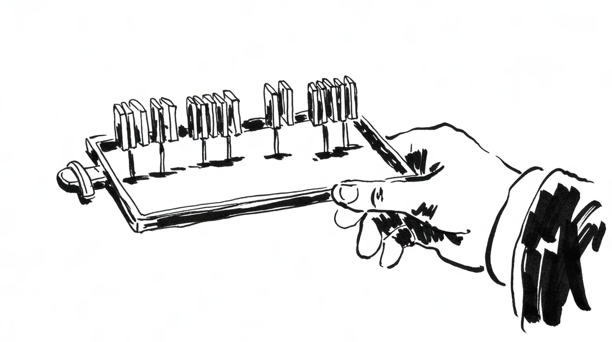

# The composing stick

**Part one of a short series on the tools of hand composition, and why they still shape the way we make pages.**

Before a page was printed, someone set it by hand, letter by letter. The compositor stood at a slanted case full of
small compartments, a piece of type in every one, and held in the left hand the most personal tool of the trade: the
composing stick.

<m data-style=ink></m>

## A tool for the left hand

A composing stick is a narrow metal tray with a movable stop. The stop is set to the width of the line, the *measure*,
and the compositor fills the tray from the left, picking each letter from the case with the right hand and placing it
upside down and backwards, so that it reads correctly once printed.

The good ones read the line as they set it, the way a musician reads ahead in a score.

## Justifying a line

A line is never exactly as wide as the measure. What is missing is filled with spaces of different widths: thin
spaces, the en quad, the em quad, cut from the same metal as the letters but lower, so they do not print. Spreading
them evenly is called *justifying*, and it was judged by touch: a well-justified line holds in the stick when you tip
it; a loose one falls apart.

## Emptying the stick

When the stick was full, perhaps eight or ten lines, the compositor lifted them out in one careful movement and slid
them onto a flat tray. That tray is the subject of part two.

## What remained

The sticks are in museums now, or on flea market tables in the Marais. But their words stayed with us: *measure*,
*leading*, *upper case* and *lower case*, after the two halves of the case. Every page on this site is still set to a
measure, even if nobody holds the stick any more.
