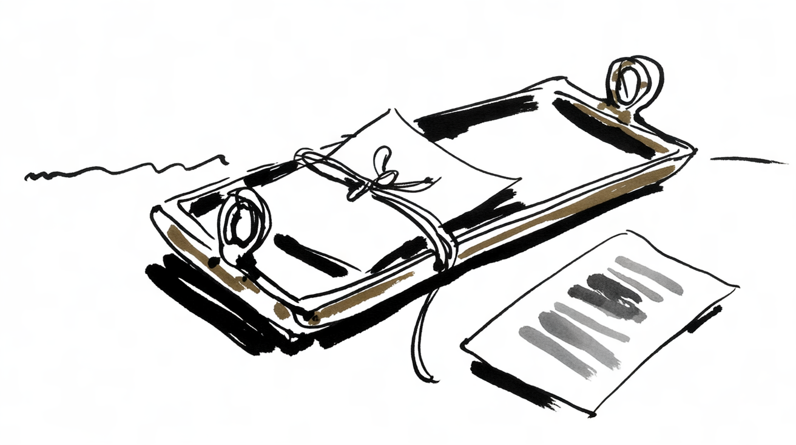

# The galley

**Part two of a short series on the tools of hand composition: where the lines waited to become a page.**

From the composing stick the lines went onto the galley: a shallow tray of brass or wood, open at one end, where the
lines stood together as a column. On the galley, the column was tied with string, inked and pressed onto a strip of
paper. That first print was the *galley proof*, and on it the corrector marked in red what was wrong.

<m data-style=ink></m>

## From galley to page

Corrected, the column was cut into pages, and the pages were locked into a heavy iron frame, the *chase*, with wedges
and spacing material until nothing could move. Only then did the page go to press.

## Names that stayed

This site is built by hadley, a static site generator whose parts are named after this workshop. The names are not
decoration; each says what the part does:

| In the workshop | What it was | In hadley |
| :--- | :--- | :--- |
| case | the tray of compartments for the type | `case`, which reads the content |
| galley | the tray where lines become a column | galley, the template language |
| chase | the frame that locks a page | `.chase`, a template of a whole page |
| sort | a single piece of type | `.sort`, a partial, one piece of a template |
| quad | the spacing that fills a line | quad, which tidies the HTML |

## Setting this site

A compositor set the measure before the first letter. A site says what it is before the first page, in its
`config.lima`. This is part of this site's:

```lima
site:
  origin: https://example.org
  default:
    language: en
    title: Feather Cat

navigations:
  main: [about]
  footer: [about, imprint, feed]

theme:
  colorToggle: true
```

The rest is the work of the hand, now as then: one line after another.
