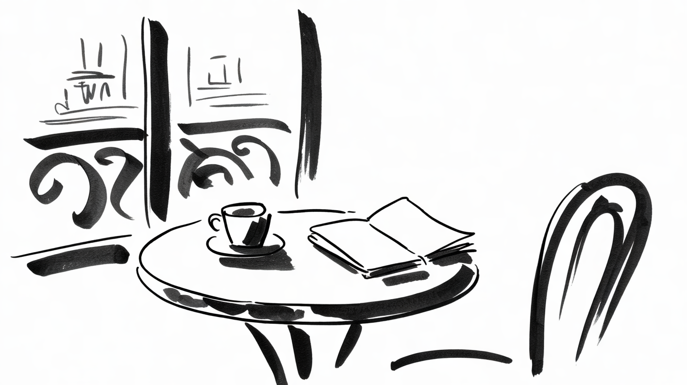

# The table by the window

**A small table, a cup and a notebook: everything a writer needs, and a little more.**

Every morning I take the same table, the one by the window on the corner of my street. It wobbles. The coffee is
average. I would not trade it for any desk in the city.

<m data-style=ink></m>

## The noise that helps

A café is never quiet, and that is the point. The clatter of saucers, the radio behind the counter and the half
conversations at the next table make a noise that asks for nothing. A silent room listens to you; a café lets you be.

Psychologists have a name for this: a *moderate* level of noise seems to help some kinds of creative work, while
silence and loud noise do not.[^1] I did not need the study. I needed the table.

## The window

The window does two things. It gives the eye somewhere to rest between sentences, and it keeps the world in view: the
baker who opens at seven, the man who walks his dog at half past, the schoolchildren who run because they are always
late. Nothing in my notebook happens in this street, and yet all of it starts here.

> A writer needs a window more than a view.
>
> -- My grandmother, who never wrote a line

## What I bring

Very little, on purpose:

- a notebook with plain pages, because lines tell you how to write;
- a pencil, because ink does not forgive and coffee does not either;
- no laptop before ten.

The laptop comes later, at home, when the notes become text and the text becomes a page on this site. But the first
sentence, the one that decides everything, is written by the window.

## A small rule

If the table is taken, I do not write. I walk around the block and try again. On some days I walk around the block
four times. Those are not the worst days.

[^1]: Ravi Mehta, Rui Zhu and Amar Cheema: *Is Noise Always Bad? Exploring the Effects of Ambient Noise on Creative Cognition*, Journal of Consumer Research 39 (2012).
