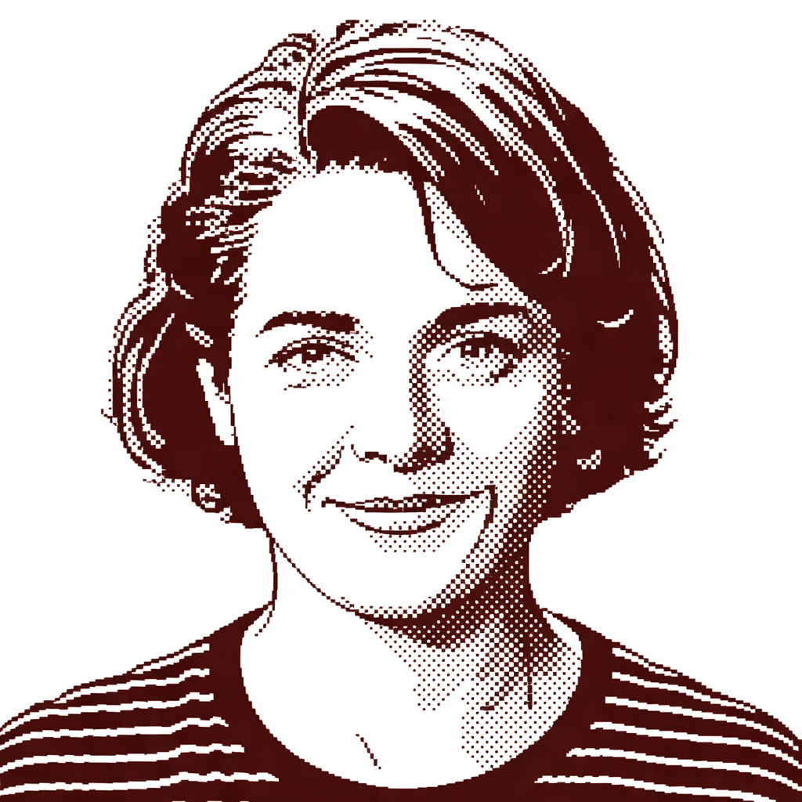

<m data-size=25% data-style=cameo></m>

I am Odile Lemoine. I write about type, tools and the slow parts of the web, mostly in the morning, mostly at
[the table by the window]($table-by-the-window).

## Why Feather Cat

The name is borrowed from a letter that was never meant for me: a nickname, *Feather Kitty*, written in pencil in the
margin of a borrowed book from a second-hand shop on the Left Bank. I liked it at once, and let the kitten grow into a
cat: lighter still, and more stubborn, which is what I would like this blog to be.

## This site

*Feather Cat* is the starter of [hadley](https://hadley.sh), and Odile is as real as the address in the
[imprint]($imprint). Everything here is meant to be replaced: the texts, the pictures, the name. Keep what helps you,
and delete the rest.
